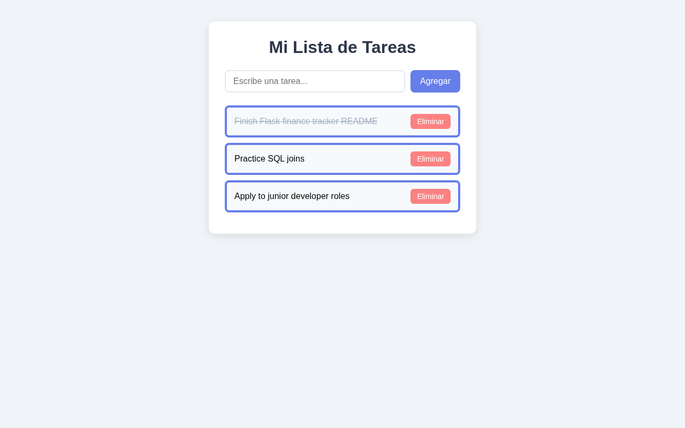
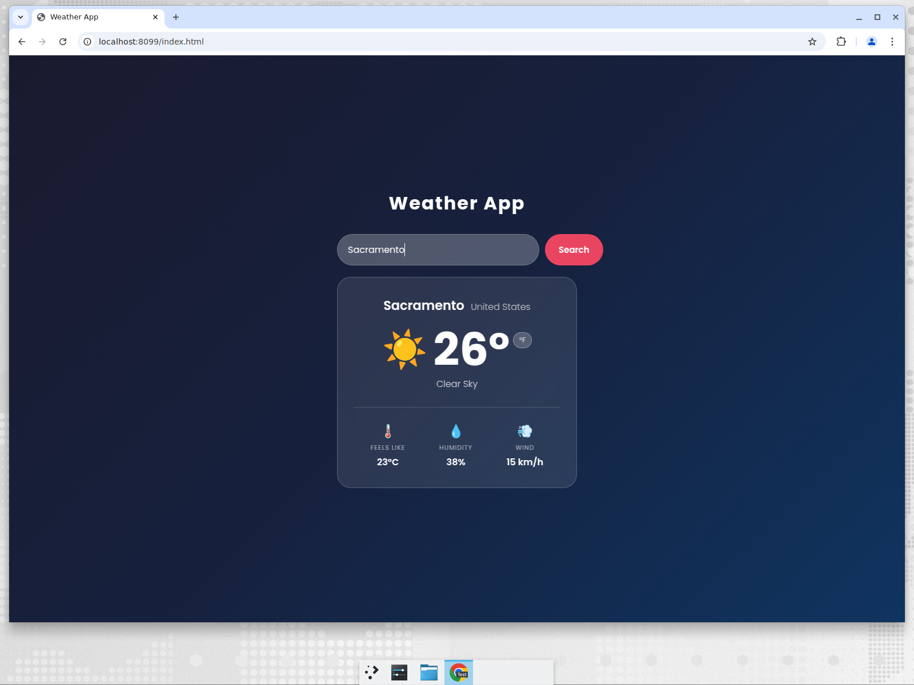
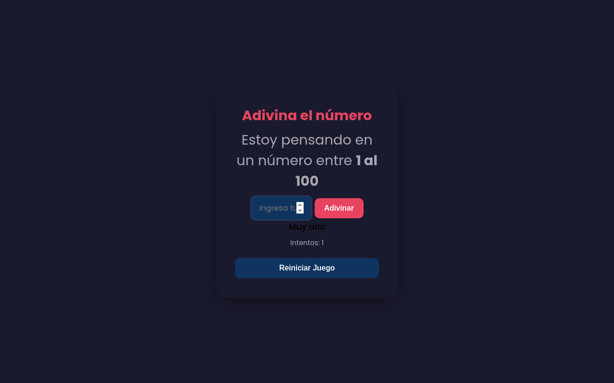

# 🧩 JavaScript Mini Projects

Three small front-end apps I built while learning vanilla JavaScript at the DUAD bootcamp, collected in one repo. Each one is plain **HTML + CSS + JavaScript** with no build step and no dependencies, and each runs live on GitHub Pages.

| Project | What it practices | Live demo |
|---------|-------------------|-----------|
| [✅ To-Do List](todo-list/) | DOM manipulation, events, `localStorage` persistence, JSON | [Open](https://coderblockch.github.io/javascript-mini-projects/todo-list/) |
| [🌤️ Weather App](weather-app/) | `async/await`, Fetch API, REST APIs (Open-Meteo geocoding + forecast), loading/error states, °C/°F toggle | [Open](https://coderblockch.github.io/javascript-mini-projects/weather-app/) |
| [🎯 Guess My Number](guess-my-number/) | Game state, input validation, hints and attempt counter, reset logic | [Open](https://coderblockch.github.io/javascript-mini-projects/guess-my-number/) |

| To-Do List | Weather App | Guess My Number |
|---|---|---|
|  |  |  |

## ✅ To-Do List
Add, complete and delete tasks. Tasks persist across reloads with `localStorage`. UI in Spanish ("Mi Lista de Tareas"). [Details →](todo-list/README.md)

## 🌤️ Weather App
Search any city and see current temperature, "feels like", humidity and wind, with weather-code icons and a °C/°F toggle. Uses the free [Open-Meteo](https://open-meteo.com/) API (no API key). [Details →](weather-app/README.md)

## 🎯 Guess My Number
Guess a random number from 1 to 100 with "too high / too low" hints, an attempt counter, validation of out-of-range input, and a reset button. UI in Spanish ("Adivina el número"). [Details →](guess-my-number/README.md)

## Run locally

```bash
git clone https://github.com/coderblockch/javascript-mini-projects.git
cd javascript-mini-projects
python3 -m http.server 8000
# open http://localhost:8000/todo-list/, /weather-app/ or /guess-my-number/
```

## Origin

These projects previously lived in separate repositories (`coderblockch/todo-list`, `coderblockch/weather-app`, `coderblockch/guess-my-number`). They were copied here unchanged (only README links updated) from commits `b902c34`, `0484ff2` and `7930f32` to keep my profile focused on larger projects.

👉 For my main full-stack work, see **[SacHealth OS](https://github.com/coderblockch/sachealth-os)** (FastAPI + SQL database + JWT + 43 tests).

## Author

**David Jimenez** · Sacramento, CA · [GitHub @coderblockch](https://github.com/coderblockch) · [Portfolio](https://portfolio-bay-nine-59.vercel.app)

## License

[MIT](LICENSE)
