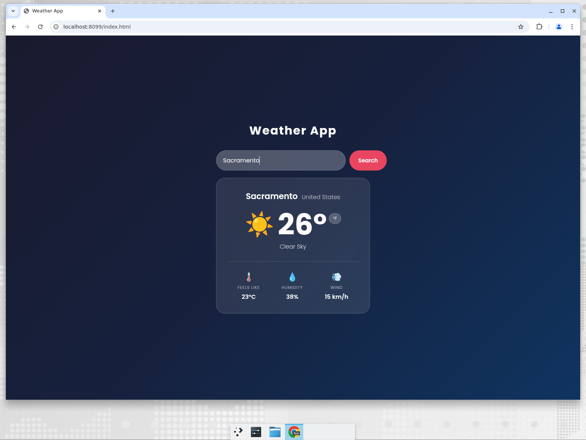

# 🌤️ Weather App

A clean, responsive weather app that shows real-time conditions for any city. Built with vanilla JavaScript and the free [Open-Meteo](https://open-meteo.com/) API — **no API key required**.

🔗 **[Live Demo](https://coderblockch.github.io/javascript-mini-projects/weather-app/)**



## Features

- 🔎 Search weather by city name (geocoding + forecast)
- 🌡️ Current temperature, "feels like", humidity, and wind speed
- 🔁 Toggle between °C and °F
- 🎨 Weather-code → icon/description mapping (clear, cloudy, rain, snow, storms…)
- ⏳ Loading and error states with graceful handling of unknown cities

## Tech Stack

- HTML5, CSS3 (Poppins font, dark UI)
- Vanilla JavaScript (ES6+, `async/await`, Fetch API)
- [Open-Meteo](https://open-meteo.com/) Geocoding & Forecast APIs

## Run Locally

No build step or dependencies. Either open `index.html` directly, or serve the folder:

```bash
git clone https://github.com/coderblockch/javascript-mini-projects.git
cd javascript-mini-projects/weather-app
python3 -m http.server 8000
# then open http://localhost:8000
```

## Project Structure

```
weather-app/
├── index.html   # markup
├── style.css    # styling
└── script.js    # geocoding, fetch, unit toggle, rendering
```

## License

[MIT](../LICENSE) © coderblockch
